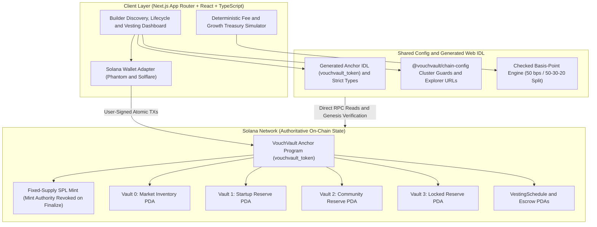
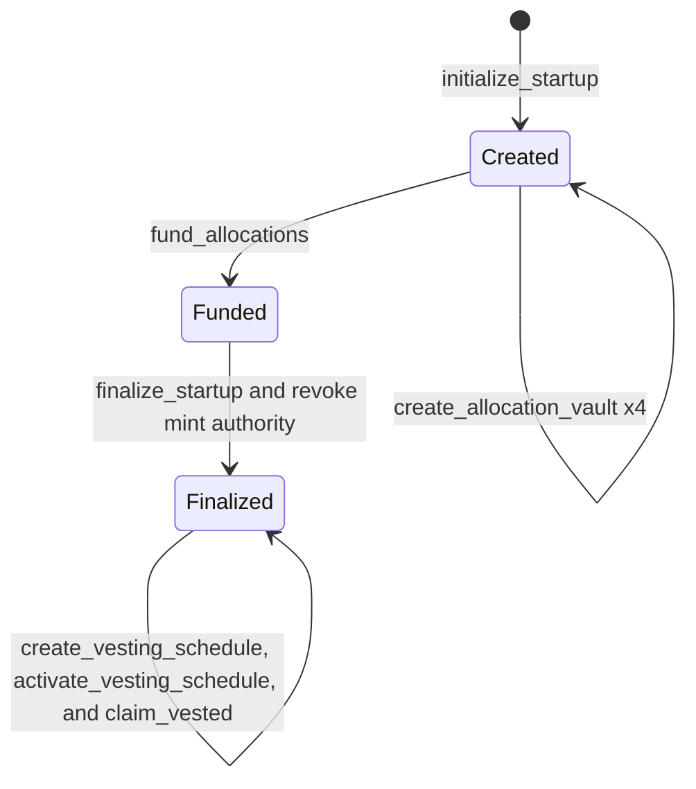

# VouchVault

**Verifiable Growth Capital & Programmable Attention Treasuries on Solana.**

> *Turn community conviction into fixed-supply, anti-rug token allocations and auditable growth treasury economics—with zero off-chain custody or database drift.*

[](https://explorer.solana.com/?cluster=devnet)
[](https://www.anchor-lang.com/)
[](https://www.typescriptlang.org/)
[](#license)

---

## 1. The Problem & Why VouchVault Exists

Early-stage builders, student founders, and emerging-market startups face a structural trust deficit when bootstrapping community distribution:

1. **Opaque Token & Marketing Budgets:** Supporters cannot verify whether allocations or growth fees stay ring-fenced or quietly leak into insider wallets.
2. **Inflation & Rug Risk:** Unverified mint authorities, freeze authorities, and informal team lockups leave early communities exposed to sudden supply dilution or instant token dumps.
3. **Off-Chain Indexer Drift:** Many Web3 launchpads rely on centralized backends and mutable databases to display project metrics, creating a gap between UI claims and verifiable on-chain truth.

**VouchVault solves this by construction on Solana.** Every project launched on VouchVault enforces an atomic, deterministic on-chain lifecycle (`Created -> Funded -> Finalized`), permanently revokes mint authority upon finalization, partitions supply across four deterministic Program Derived Address (PDA) vaults, locks team/insider allocations in immutable cliff-and-linear vesting escrows, and models growth-treasury fee splits (`50 bps` total / `50-30-20` protocol partition) through checked integer arithmetic with zero off-chain custody.

---

## 2. Core Value Proposition

| Dimension | Traditional Launch / Fundraising | VouchVault Protocol |
| :--- | :--- | :--- |
| **Supply Integrity** | Mint authority often retained by deployer | **Permanently revoked** on-chain at `Finalized` state |
| **Allocation Custody** | Held in founder EOAs or multisigs | Partitioned across **4 deterministic PDA vaults** |
| **Team & Insider Locks** | Off-chain promises or revocable scripts | **Immutable on-chain cliff + linear vesting PDAs** |
| **Growth Treasury Economics** | Opaque off-chain fee math | **Checked `u128` / `bigint` basis-point split (`50 bps` / `50-30-20`)** with exact remainder conservation |
| **Data Source of Truth** | Centralized API / PostgreSQL cache | **Zero-backend, RPC-reconciled** direct on-chain state |

---

## 3. System Architecture (Zero-Backend, Chain-Direct)

VouchVault intentionally eliminates off-chain databases and custodial servers. The web client performs discovery, PDA derivation, lifecycle recovery, vesting calculations, and fee simulations directly against Solana RPC. The shared, strictly typed `@vouchvault/chain-config` package provides cluster guards, explorer URLs, and the deterministic fee math used by the simulator.



---

## 4. On-Chain State Machine & Vault Architecture

VouchVault uses the Original SPL Token Program (no Token-2022 extensions, `freeze_authority = None`) to maximize composability and eliminate hidden transfer hooks or freeze risks.

### Deterministic Lifecycle: `Created -> Funded -> Finalized`



- **`Created` (`initialize_startup` + `create_allocation_vault`):** Initializes the `StartupConfig` PDA (`["startup", authority, startup_id]`) and `AllocationLedger` PDA (`["allocation", authority, startup_id]`), creates the SPL Mint (`["mint", authority, startup_id]`) with a canonical `MintAuthority` PDA (`["mint-authority", authority, startup_id]`) and `freeze_authority = None`, and initializes four distinct token-account vaults (`["vault", startup_config, bucket_index]` for `0..=3`). Checked integer arithmetic asserts `market_inventory + startup_reserve + community_reserve + locked_reserve == total_supply`.
- **`Funded` (`fund_allocations`):** Mints the exact configured base-unit allocation into each of the four PDA vaults and verifies `mint.supply == total_supply`. Built-in UI recovery steppers detect incomplete `Created` or `Funded` states and allow builders to resume safely without orphaned accounts or double-minting.
- **`Finalized` (`finalize_startup`):** Verifies all four vault balances and absence of freeze authority on-chain, permanently revokes mint authority (`SetAuthority::MintTokens -> None`), and records `finalized_at`. No additional tokens can ever be minted, and there is no arbitrary reserve withdrawal instruction.

### Four-Vault Supply Partition

| Vault PDA (`bucket_index`) | On-Chain Enforcement |
| :--- | :--- |
| **0. Market Inventory Vault** | Reserved exclusively for controlled market inventory; held by the canonical vault authority PDA and isolated from founder withdrawal. |
| **1. Startup Reserve Vault** | Dedicated operational builder reserve held in a program-controlled PDA with transparent on-chain balance tracking. |
| **2. Community Reserve Vault** | Ring-fenced allocation for community incentives, grants, and ecosystem participation. |
| **3. Locked Reserve Vault** | Backing reserve for immutable, capped vesting schedules (`create_vesting_schedule`, `activate_vesting_schedule`, `claim_vested`) using `VestingSchedule` (`["vesting", startup_config, schedule_id]`) and `Escrow` (`["vesting-escrow", startup_config, schedule_id]`) PDAs. Beneficiary claims execute atomically with idempotent Associated Token Account (ATA) creation. |

---

## 5. Deterministic Economic & Treasury Split Specification

All protocol fee and vesting math executes strictly in checked integer base units (`u64` / `u128` in Rust `vouchvault_token::treasury_math`, `bigint` in `@vouchvault/chain-config::calculateTreasuryFeeSplit`). Floating-point arithmetic is prohibited. Fees round down conservatively, and remainder conservation guarantees zero base-unit leakage.

> **Scope Note:** In the current milestone, the `50 bps` / `50-30-20` fee split engine is implemented as a parity-tested deterministic math module in both Rust (`treasury_math`) and TypeScript (`@vouchvault/chain-config`), wired directly into the **Treasury simulator** tab in the web UI. On-chain swap/fee-routing instructions are not yet deployed on Devnet.

### Fee & Allocation Formulas

For any non-negative gross quote notional amount $Q$ (in integer base units):

- **Total Protocol + LP Fee ($\text{50 bps} = 0.50\%$):**

  $$F = \left\lfloor \frac{Q \times 50}{10{,}000} \right\rfloor$$

- **Protocol Share ($\text{20 bps} = 0.20\%$):**

  $$P = \left\lfloor \frac{Q \times 20}{10{,}000} \right\rfloor$$

- **Liquidity Pool Retained Fee ($\text{30 bps} = 0.30\%$):**

  $$L = F - P$$

The protocol share $P$ is deterministically partitioned across three accounting buckets so that $T_{\text{growth}} + T_{\text{protocol}} + T_{\text{risk}} \equiv P$:

- **Builder Growth Treasury ($50\%$):**

  $$T_{\text{growth}} = \left\lfloor \frac{P \times 50}{100} \right\rfloor$$

- **Protocol Sustainability Reserve ($30\%$):**

  $$T_{\text{protocol}} = \left\lfloor \frac{P \times 30}{100} \right\rfloor$$

- **Risk & Operations Buffer ($20\%$ remainder):**

  $$T_{\text{risk}} = P - T_{\text{growth}} - T_{\text{protocol}}$$

### Worked Reference Vector (`1,000.000000 USDC`, 6 decimals)

| Metric | Formula | Exact Base Units | Human-Readable |
| :--- | :--- | ---: | ---: |
| **Gross Notional ($Q$)** | Input | `1,000,000,000` | `1,000.000000` |
| **Effective Net Notional ($Q - F$)** | `1,000,000,000 - 5,000,000` | `995,000,000` | `995.000000` |
| **Total Fee ($F$, 50 bps)** | `floor(Q * 50 / 10_000)` | `5,000,000` | `5.000000` |
| **LP Fee Retained ($L$, 30 bps)** | `F - P` | `3,000,000` | `3.000000` |
| **Protocol Fee ($P$, 20 bps)** | `floor(Q * 20 / 10_000)` | `2,000,000` | `2.000000` |
| **↳ Builder Growth Treasury (50%)** | `floor(P * 50 / 100)` | `1,000,000` | `1.000000` |
| **↳ Protocol Reserve (30%)** | `floor(P * 30 / 100)` | `600,000` | `0.600000` |
| **↳ Risk & Ops Buffer (20%)** | `P - 1,000,000 - 600,000` | `400,000` | `0.400000` |

> **Transparency Guarantee:** Deterministic PDA custody and checked integer splits prove capital allocation rules by construction—they make no unbacked financial return promises or off-chain performance guarantees.

---

## 6. Security & Engineering Invariants

- **Zero Server Custody:** Private keys never touch a server or browser environment variable; every state transition is signed directly by the user's connected wallet (Phantom, Solflare).
- **No Freeze Authority / No Hidden Extensions:** Mints are created via `initialize_mint2` with `freeze_authority = None` using the audited SPL Token Program.
- **Permanent Supply Cap:** `finalize_startup` revokes mint authority on-chain and verifies exact vault balances before setting `LifecycleState::Finalized`.
- **Checked Arithmetic Everywhere:** All Rust instructions and math helpers use `checked_add`, `checked_sub`, `checked_mul`, and `checked_div` (`u128` intermediate precision) to prevent overflow or silent truncation.
- **Wallet-Switch State Isolation:** Switching wallets in the browser immediately clears pending transaction states, cached signer context, and simulation drafts to prevent cross-account signing errors.
- **Cluster Guardrails:** `@vouchvault/chain-config` validates genesis hashes and canonical RPC endpoints (`devnet` or loopback `localnet`) prior to constructing transactions.

---

## 7. Live Devnet Deployment & Verification

Populate the table below after deploying `vouchvault_token` to Solana Devnet and finalizing a reference demonstration token:

| Parameter | Verified Value |
| :--- | :--- |
| **Network** | Solana Devnet (`https://api.devnet.solana.com`) |
| **Genesis Hash** | `EtWTRABZaYq6iMfeYKouRu166VU2xqa1wcaWoxPkrZBG` |
| **Program ID** | `<YOUR_NEW_DEVNET_PROGRAM_ID>` |
| **Deployment Signature** | `<YOUR_DEPLOYMENT_TX_SIGNATURE>` |
| **Program Binary SHA-256** | `<YOUR_VERIFIED_ELF_SHA256>` |
| **Demo Project Mint** | `<YOUR_DEMO_PROJECT_MINT_ADDRESS>` |
| **Finalization TX** | `<YOUR_FINALIZE_MINT_REVOCATION_TX>` |

*All deployment artifacts and transactions can be independently verified on [Solana Explorer (Devnet)](https://explorer.solana.com/?cluster=devnet).*

The placeholders above are intentionally empty until a real Devnet deployment and demo are completed. To populate them, install the pinned toolchain and fund the deployer with Devnet SOL, then set `ANCHOR_WALLET` to the deployer keypair path and `VOUCHVAULT_PROGRAM_KEYPAIR` to the matching program keypair path. Run `pnpm anchor:build`, `pnpm idl:sync`, `pnpm idl:check`, `pnpm devnet:preflight`, then `VOUCHVAULT_DEPLOY_AUTHORIZED=YES pnpm devnet:deploy`. Record the program address and deployment signature printed by Solana CLI. Calculate the binary hash with `sha256sum target/deploy/vouchvault_token.so`, then create and finalize a reference project through the Devnet UI and record its mint and finalization transaction from the wallet or Explorer. The deployment script requires explicit authorization and the preflight must pass before it deploys.

---

## 8. Repository Structure

```text
vouch-vault/
├── programs/
│   └── vouchvault-token/
│       ├── Cargo.toml           # Crate manifest (vouchvault-token / vouchvault_token)
│       └── src/lib.rs           # Anchor 1.2.2 program (lifecycle, 4 vaults, vesting, treasury_math)
├── packages/
│   ├── chain-config/
│   │   ├── package.json         # @vouchvault/chain-config
│   │   ├── src/index.ts         # Cluster guards, explorer URLs, checked integer fee math
│   │   └── test/index.test.ts   # Vitest suite (cluster guards + 1,000.000000 reference vector)
│   └── web/
│       ├── package.json         # @vouchvault/web (Next.js 16 App Router)
│       ├── next.config.ts       # Webpack & wallet-adapter configuration
│       ├── AGENTS.md            # Next.js repository guidance
│       └── src/
│           ├── app/             # Layout, global styles, main workspace view
│           ├── components/      # Overview, CreateStartupWizard, VestingManager, TreasurySimulator
│           ├── generated/       # Synced Anchor IDL & TS types (vouchvault_token)
│           └── lib/             # Chain client, config, lifecycle state, wallet guards, tests
├── scripts/
│   ├── check-web-idl.mjs        # Verifies packages/web/src/generated matches target/idl
│   ├── deploy-devnet.sh         # Guarded Devnet deployment script
│   ├── devnet-preflight.mjs     # Read-only Devnet toolchain, ELF, and authority preflight
│   ├── test-local-validator.mjs # Ephemeral solana-test-validator integration test runner
│   └── verify-env.mjs           # Pinned Node/pnpm/Rust/Anchor/Solana version verifier
├── tests/
│   └── token-lifecycle.ts       # Anchor integration tests against local validator
├── toolchain/
│   ├── Containerfile            # Reproducible Ubuntu 24.04 + Solana/Anchor build environment
│   └── run-verification.sh      # Full isolated verification script (Podman/Docker)
├── Anchor.toml                  # Anchor workspace & localnet program configuration
├── Cargo.toml                   # Rust workspace manifest
├── eslint.config.mjs            # Root ESLint 9 flat config
├── package.json                 # pnpm monorepo scripts (build, test, lint, typecheck, idl:sync)
├── .npmrc                       # pnpm workspace configuration
├── pnpm-workspace.yaml          # pnpm workspace definition
├── .nvmrc                       # Node.js major version pin
├── tsconfig.base.json           # Shared TypeScript strict compiler options
├── tsconfig.json                # Root test TypeScript project config
└── README.md
```

---

## 9. Quickstart & Local Verification

### Prerequisites

- **Node.js** `>= 24 < 25` (`v24.22.0` recommended, see `.nvmrc`) & **pnpm** `12.11.2`
- **Rust** `1.99.1`, **Solana CLI** `4.1.2`, and **Anchor CLI** `1.2.2` (for SBF builds, `idl:check`, and local validator tests; or use `./toolchain/run-verification.sh` with Podman/Docker)

### 1. Install Dependencies

```bash
pnpm install
```

### 2. Run Full Verification Suite (Config, Math Parity, Web UI & Typecheck)

```bash
# Run shared chain-config, cluster guards, and deterministic integer math tests
pnpm --filter @vouchvault/chain-config test

# Run frontend component, IDL, PDA, and treasury math parity tests
pnpm --filter @vouchvault/web test

# Verify strict TypeScript compilation, linting, and production build
pnpm typecheck
pnpm lint
pnpm build

# Run Rust unit tests (vesting math + treasury_math parity tests)
cargo test --workspace
```

### 3. Build Anchor Program, Sync IDL & Run Validator Integration Tests

Requires the Solana/Anchor toolchain (`anchor build` + `solana-test-validator`):

```bash
pnpm anchor:build
pnpm idl:check
pnpm test:validator
```

`pnpm test:validator` starts an isolated local validator and runs the Anchor lifecycle integration tests. The equivalent `anchor test` command is also available, but Anchor CLI 1.2.2 requires Surfpool for its test runner; install Surfpool first if you prefer that runner.

### 4. Start the Web Application Locally

```bash
pnpm --filter @vouchvault/web dev
```

Open `http://localhost:3000` to inspect live Devnet projects without a wallet, simulate growth treasury fee splits in the **Treasury simulator** tab, or connect Phantom/Solflare on Devnet to initialize a project, resume a lifecycle, or claim vested tokens.

---

## License

MIT
